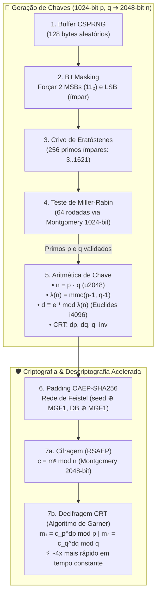
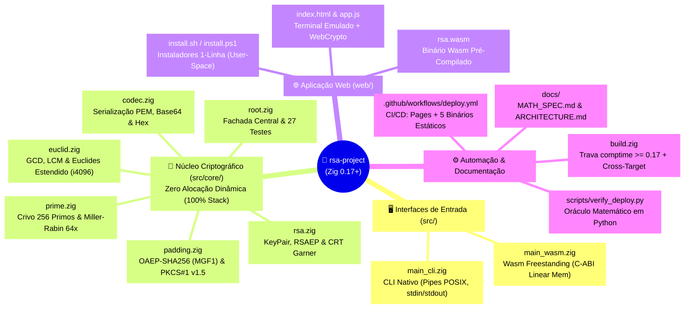

# 🔐 RSA-2048 em Zig Puro

Implementação completa, didática e de alta performance do protocolo criptográfico **RSA-2048** em **Zig** (padrão 0.17+), projetada para compilar tanto para **binários CLI 100% estáticos** (Linux, Windows, macOS em x86_64 e ARM64) quanto para **WebAssembly freestanding** (rodando em um terminal interativo no navegador via GitHub Pages).

---

## 📖 COMO USAR

O projeto pode ser utilizado de duas formas principais (**Binário CLI Nativo** ou **Modo WebAssembly**) e foi desenhado para rodar em **qualquer máquina — inclusive em computadores públicos ou de terceiros onde você não tem permissão de administrador nem o compilador Zig instalado**.

### 🖥️ Parte 1: Executando em Computador de Terceiros / Público (Sem Instalar Zig)

Se você está em um laboratório de informática, computador público ou máquina de terceiros sem o compilador Zig e sem acesso `root`/Administrador, além do **[GitHub Pages](https://o-gariba.github.io/rsa-zig-seguranca-info-fatec-rp/)**, você possui **5 formas práticas** de executar o projeto:

#### 1. Instalação Automática em User-Space (1 Linha — Sem `sudo`/Admin)
Os scripts abaixo detectam seu sistema operacional e arquitetura, baixam o binário 100% estático para `$HOME/.local/bin` (espaço de usuário) e executam uma demonstração automática ponta a ponta:

- **Linux & macOS (`curl`):**
  ```bash
  curl -sSL https://o-gariba.github.io/rsa-zig-seguranca-info-fatec-rp/install.sh | sh
  ```
- **Windows (`PowerShell`):**
  ```powershell
  irm https://o-gariba.github.io/rsa-zig-seguranca-info-fatec-rp/install.ps1 | iex
  ```

#### 2. Execução Efêmera em Pasta Temporária (`/tmp` ou Pendrive) — Zero Instalação
Como os binários gerados pelo CI/CD são **100% estáticos** (`musl` no Linux, `mingw` no Windows — sem dependência de DLLs ou `glibc`), você pode baixar o executável diretamente da aba **[GitHub Releases](https://github.com/o-gariba/rsa-zig-seguranca-info-fatec-rp/releases/latest)** para `/tmp` (ou `$env:TEMP`) e executá-lo sem deixar rastros no sistema:

- **Linux (`x86_64`) direto em `/tmp`:**
  ```bash
  curl -sSL https://github.com/o-gariba/rsa-zig-seguranca-info-fatec-rp/releases/latest/download/rsa-cli-linux-x86_64 -o /tmp/rsa-cli
  chmod +x /tmp/rsa-cli
  /tmp/rsa-cli keygen --pub /tmp/id.pub --priv /tmp/id.key --inspect
  ```
- **Windows (`x86_64`) direto em `$env:TEMP`:**
  ```powershell
  Invoke-WebRequest -Uri "https://github.com/o-gariba/rsa-zig-seguranca-info-fatec-rp/releases/latest/download/rsa-cli-windows-x86_64.exe" -OutFile "$env:TEMP\rsa-cli.exe"
  & "$env:TEMP\rsa-cli.exe" keygen --pub "$env:TEMP\id.pub" --priv "$env:TEMP\id.key" --inspect
  ```
*(Arquivos disponíveis nas Releases: `rsa-cli-linux-x86_64`, `rsa-cli-linux-aarch64`, `rsa-cli-windows-x86_64.exe`, `rsa-cli-macos-x86_64`, `rsa-cli-macos-aarch64`).*

#### 3. Rodar o Modo WebAssembly Localmente (Offline / Sem GitHub Pages)
O motor WebAssembly compilado (**`web/rsa.wasm`**) **já está versionado dentro do repositório**. Se você baixar o `.zip` do projeto (ou fizer `git clone`), não precisa do Zig para abrir a aplicação Web localmente; basta iniciar um servidor HTTP estático na pasta `web/` com qualquer ferramenta padrão já presente na máquina:

```bash
# Opção com Python 3 (nativo na maioria das distribuições Linux/macOS e laboratórios):
python3 -m http.server 8080 --directory web

# Opção com Node.js (se disponível):
npx serve web

# Opção com PHP (se disponível):
php -S localhost:8080 -t web
```
Em seguida, acesse **`http://localhost:8080`** no navegador.

#### 4. Executar o `web/rsa.wasm` via Node.js no Terminal (Contornando Bloqueio de Binários)
Em computadores públicos com políticas rígidas (como Windows SmartScreen/AppLocker ou partições Linux montadas com `noexec` que impedem a execução de binários nativos baixados), se houver **Node.js** instalado, você pode rodar o motor criptográfico `web/rsa.wasm` diretamente no terminal via engine V8:

```bash
node -e '
const fs = require("fs"), crypto = require("crypto");
(async () => {
  const { instance } = await WebAssembly.instantiate(fs.readFileSync("web/rsa.wasm"), {});
  const w = instance.exports, mem = () => new Uint8Array(w.memory.buffer);
  crypto.randomFillSync(new Uint8Array(w.memory.buffer, w.wasm_get_seed_ptr(), 64));
  w.wasm_keygen(32);
  console.log("=== INSPEÇÃO WASM (JSON) ===");
  console.log(Buffer.from(w.memory.buffer, w.wasm_get_inspect_ptr(), w.wasm_get_inspect_len()).toString());
})();
'
```

#### 5. Execução em Nuvem pelo Navegador (GitHub Codespaces / Google Cloud Shell)
Se a máquina pública só permitir o uso do navegador e bloquear o terminal local, clique no botão **`Code` ➔ `Codespaces` ➔ `Create codespace on main`** no topo deste repositório no GitHub (ou pressione a tecla `.` / use o Google Cloud Shell) para abrir um ambiente Linux completo e gratuito diretamente no navegador.

---

### 💻 Parte 2: Como Usar o Binário Nativo (`rsa-cli`)

O executável nativo segue a filosofia UNIX: suporta arquivos explícitos (`--in` e `--out`) e *pipes* POSIX (`stdin` e `stdout`). Todos os relatórios matemáticos e de tempo (`--inspect`) são emitidos exclusivamente em `stderr`, garantindo que o `stdout` contenha apenas o resultado puro para encadeamento de comandos.

#### Sintaxe Geral
```text
rsa-cli keygen  [--pub <arq>] [--priv <arq>] [--inspect]
rsa-cli encrypt --pub <arq> [<mensagem>] [--in <arq>] [--out <arq>] [--inspect]
rsa-cli decrypt --priv <arq> [<cifra_b64>] [--in <arq>] [--out <arq>] [--inspect]
```

#### 1. Geração de Chaves RSA-2048 (`keygen`)
Gera os primos $p$ e $q$ de 1024 bits (64 rodadas de Miller-Rabin), calcula $n = p \cdot q$, o totiente $\lambda(n)$, o inverso modular $d$ e os parâmetros CRT ($d_p, d_q, q_{\text{inv}}$), salvando as chaves em formato PEM:
```bash
./zig-out/bin/rsa-cli keygen --pub id_rsa.pub --priv id_rsa.key --inspect
```
*(Se `--pub` e `--priv` forem omitidos, utiliza por padrão `id_rsa.pub` e `id_rsa.key`).*

#### 2. Criptografia OAEP-SHA256 (`encrypt` — Máx. 190 bytes)
- **Direto por Argumento Posicional (Recomendado):**
  ```bash
  ./zig-out/bin/rsa-cli encrypt --pub id_rsa.pub "Mensagem ultra confidencial" --inspect > msg.enc
  ```
- **Via Pipe POSIX (`stdin` ➔ `stdout`):**
  ```bash
  echo "Mensagem ultra confidencial" | ./zig-out/bin/rsa-cli encrypt --pub id_rsa.pub --inspect > msg.enc
  ```
- **Via Flags de Arquivo (`--in` e `--out`):**
  ```bash
  ./zig-out/bin/rsa-cli encrypt --pub id_rsa.pub --in mensagem.txt --out msg.enc --inspect
  ```

#### 3. Descriptografia Acelerada via CRT (`decrypt` — Algoritmo de Garner)
- **Direto por Argumento Posicional:**
  ```bash
  ./zig-out/bin/rsa-cli decrypt --priv id_rsa.key "<cifra_base64>" --inspect
  ```
- **Via Redirecionamento POSIX (`stdin`):**
  ```bash
  ./zig-out/bin/rsa-cli decrypt --priv id_rsa.key --inspect < msg.enc
  ```
- **Via Flags de Arquivo (`--in` e `--out`):**
  ```bash
  ./zig-out/bin/rsa-cli decrypt --priv id_rsa.key --in msg.enc --out decifrado.txt --inspect
  ```

*Saída de inspeção no `stderr`:*
```text
=== COMPARAÇÃO CRT vs EXPONENCIAÇÃO DIRETA ===
  Tempo CRT (Algoritmo de Garner) : 2126 μs
  Tempo Direto (c^d mod n)       : 6090 μs
  Aceleração observada            : 2.86x mais rápido
==============================================
Mensagem ultra confidencial
```

---

### 🌐 Parte 3: Como Usar o Modo WebAssembly (`rsa.wasm`)

Acesse a aplicação interativa pelo **[GitHub Pages](https://o-gariba.github.io/rsa-zig-seguranca-info-fatec-rp/)** ou pelo servidor local (`http://localhost:8080`). O módulo `rsa.wasm` (*freestanding*) se comunica diretamente com o JavaScript via memória linear (`ArrayBuffer`) e coleta entropia real do navegador via `window.crypto.getRandomValues()`.

Você pode utilizar a interface Web de **duas maneiras**:

#### 1. Pelos Botões de Demonstração Rápida
1. **`1. Gerar Chaves (Keygen)`**: Executa o Crivo de 256 Primos + Miller-Rabin no WebAssembly e atualiza o painel de fórmulas com os valores hexadecimais reais de $p, q, n, d, d_p, d_q, q_{\text{inv}}$.
2. **`2. Criptografar (OAEP)`**: Aplica o preenchimento probabilístico OAEP-SHA256 e exibe o criptograma em Base64 (344 caracteres).
3. **`3. Decifrar (CRT Garner)`**: Executa a descriptografia acelerada pelo Teorema Chinês dos Restos e restaura a mensagem original.

#### 2. Pelo Terminal Interativo Emulado (`user@rsa-zig:~$`)
Clique na caixa de comando do terminal na página e digite qualquer um dos comandos abaixo (use as setas `↑` e `↓` para navegar pelo histórico):

| Comando no Terminal Web | Descrição |
| :--- | :--- |
| `help` | Exibe a lista de comandos disponíveis no terminal Web. |
| `rsa keygen` | Gera um novo par de chaves RSA-2048 na memória linear do WebAssembly. |
| `rsa encrypt <mensagem>` | Criptografa qualquer texto personalizado (até 190 bytes UTF-8) usando OAEP-SHA256. |
| `rsa decrypt` | Descriptografa a última cifra gerada na sessão via Algoritmo de Garner (CRT). |
| `rsa decrypt <cifra_b64>` | Descriptografa um criptograma Base64 específico (344 caracteres) informado manualmente. |
| `rsa inspect` | Imprime no terminal todos os parâmetros matemáticos atuais ($e, p, q, n, d, d_p, d_q, q_{\text{inv}}$). |
| `clear` | Limpa a tela do terminal interativo. |

---

## 🏛️ Diretrizes Arquiteturais (Cenário 3)

O projeto adota uma arquitetura pragmática de baixo nível em Zig:

1. **Zero Alocação Dinâmica no Núcleo (`src/core/`):** Todo o cálculo da teoria dos números opera exclusivamente na stack da thread (buffers de tamanho fixo e structs passadas por valor). Zero chamadas ao heap alocador (`std.mem.Allocator`), garantindo execução eficiente em hardware restrito e compatibilidade direta com `wasm32-freestanding`.
2. **Divisão Estrita entre Módulos Ímpares e Pares:**
   - **Montgomery (`std.crypto.ff.Modulus`):** Utilizado onde o módulo é matematicamente ímpar ($\gcd(N, 2^{64}) = 1$): teste de primalidade de Miller-Rabin (módulo $p$), criptografia pública (módulo $n = p \cdot q$) e exponenciações CRT (módulos $p$ e $q$).
   - **Euclides Estendido Manual com `i4096`:** Como o totiente de Carmichael $\lambda(n) = \text{mmc}(p-1, q-1)$ é **SEMPRE PAR**, Montgomery falharia com `error.EvenModulus`. A inversão modular para obter $d \equiv e^{-1} \pmod{\lambda(n)}$ foi implementada manualmente sobre o tipo inteiro com sinal `i4096`.
3. **Proteções Criptográficas de Baixo Nível:**
   - Limpeza de chaves privadas e segredos na stack com `std.crypto.secureZero`, prevenindo *Dead-Store Elimination* (DSE) pelo otimizador do compilador.
   - Descriptografia em tempo constante com `.pow()` para imunidade contra ataques de temporização (*timing attacks*).
4. **Preenchimento Probabilístico:** Suporte a **OAEP** com SHA-256 e MGF1 (RFC 8017) e modo didático **PKCS#1 v1.5**.
5. **A Filosofia do Zig vs. Docker (Cross-Compilation Nativa e Zero Runtime):**
   - Em vez de containers Docker volumosos com toolchains fragmentadas, o projeto abraça a filosofia do Zig: o compilador já traz embutidas todas as bibliotecas padrão de sistema (`musl`, `mingw-w64`, `wasm32-freestanding`).
   - Um único comando `zig build` a partir de qualquer sistema compila binários estáticos para Linux, Windows, macOS e WebAssembly sem dependências dinâmicas nem virtualização.
6. **Trava Arquitetural em Tempo de Compilação (`comptime`):**
   - O `build.zig` inclui uma verificação `comptime` que valida `builtin.zig_version >= 0.17.0`. Caso um compilador legado seja invocado, o build aborta instantaneamente com uma mensagem descritiva antes de qualquer compilação de código.

---

## 📐 As 7 Etapas Matemáticas

A fundamentação teórica completa, deduções e provas de corretude estão detalhadas em **[`docs/MATH_SPEC.md`](docs/MATH_SPEC.md)**:



---

## 🛠️ Compilação e Testes Locais

Requer o compilador Zig instalado:

```bash
# Executar a suíte completa de 27 testes matemáticos
zig build test --summary all

# Executar testes por etapa fechada
zig build test-etapa1   # GCD, LCM e Euclides Estendido (i4096)
zig build test-etapa2   # Crivo de 256 Primos e Miller-Rabin (64 rodadas)
zig build test-etapa3   # Padding OAEP, PKCS#1 v1.5, PEM e Base64
zig build test-etapa4   # Núcleo RSA-2048 e Teorema Chinês dos Restos (CRT)

# Compilar o binário CLI nativo estático
zig build -Doptimize=ReleaseFast

# Compilar o módulo WebAssembly para a pasta web/
zig build wasm
```

### 🔬 Oráculo Algébrico e Verificador Pré-Deploy (Python + Zig + Node.js)
Para garantir que a matemática de 2048 bits e os pipelines de CI/CD estejam 100% corretos antes de qualquer `git push`, utilize o verificador integrado:
```bash
python3 scripts/verify_deploy.py
```
Este script utiliza o motor de precisão arbitrária nativo do Python como um **Oráculo Matemático (*Ground Truth*)**:
- Prova formalmente $p \cdot q = n$ (2048 bits);
- Valida o totiente $\lambda(n) = \text{mmc}(p-1, q-1)$ e o inverso modular $(e \cdot d) \equiv 1 \pmod{\lambda(n)}$;
- Valida os expoentes CRT e o coeficiente de Garner $(q \cdot q_{\text{inv}}) \equiv 1 \pmod p$;
- Testa a criptografia/descriptografia ponta a ponta com pipes POSIX e instancia o módulo `web/rsa.wasm` via Node.js (V8).

### Guia para Desenvolvedores
Para inspecionar ou editar o código-fonte, utilize sempre o editor `vim`:
```bash
vim src/core/rsa.zig
vim src/core/euclid.zig
vim src/core/prime.zig
```

---

## 🗺️ Mapa Visual do Código e Estrutura de Diretórios



<details>
<summary>📁 <b>Ver árvore de arquivos em texto</b></summary>

```text
rsa-project/
├── .github/
│   └── workflows/
│       └── deploy.yml        # CI/CD: Testes, GitHub Pages e Releases
├── build.zig                 # Build system com testes por etapa e alvos nativo/wasm
├── scripts/
│   └── verify_deploy.py      # Oráculo matemático em Python e verificador pré-deploy
├── README.md                 # Visão geral, instruções e comandos rápidos
├── docs/
│   ├── ARCHITECTURE.md       # Decisões de arquitetura, limites de stack e DSE
│   └── MATH_SPEC.md          # Especificação didática e demonstrações matemáticas
├── src/
│   ├── main_cli.zig          # Ponto de entrada CLI (POSIX pipes, std.Io)
│   ├── main_wasm.zig         # Ponto de entrada WebAssembly freestanding (C-ABI)
│   └── core/
│       ├── root.zig          # Fachada central e suíte de testes de integração
│       ├── euclid.zig        # MDC, MMC e Inverso Modular com u2048 e i4096
│       ├── prime.zig         # Crivo de 256 primos e Miller-Rabin de 64 rodadas
│       ├── padding.zig       # OAEP-SHA256 (MGF1) e PKCS#1 v1.5
│       ├── rsa.zig           # KeyPair, RSAEP e RSADP via Algoritmo de Garner (CRT)
│       └── codec.zig         # Serialização PEM (Base64), Cifras e Hexadecimal
└── web/
    ├── index.html            # Emulador de Terminal Web + Painel das Fórmulas
    ├── app.js                # Loader Wasm e integração com WebCrypto API
    ├── rsa.wasm              # Motor WebAssembly freestanding compilado
    ├── install.sh            # Script de instalação em 1 linha (Linux/macOS)
    └── install.ps1           # Script de instalação em 1 linha (Windows PowerShell)
```
</details>

## 🧠 Mapa Mental

```
mindmap
  root(("🔐 RSA-2048 em Zig Puro
  Fachada: src/core/root.zig
  Zero Heap / 100% Stack"))

    {{"[FASE 1] Base Aritmética e Limites de Stack
    Arquivos: src/core/rsa.zig, prime.zig, euclid.zig"}}
      ["[1.1 - REPRESENTAÇÃO] Decomposição Posicional em Limbs Radix-64 (B = 2^64)
      Arquivos: src/core/prime.zig e src/core/rsa.zig"]
        ("[1.1.1 - CÓDIGO] Primos p e q alocados na stack como u1024: 16 limbs de 64 bits (128 bytes) em src/core/prime.zig")
        ("[1.1.2 - CÓDIGO] Módulo público n e chave privada d como u2048: 32 limbs de 64 bits (256 bytes) em src/core/rsa.zig")
      ["[1.2 - OVERFLOW] Prevenção Matemática de Truncamento Modular na Stack
      Arquivos: src/core/rsa.zig e src/core/euclid.zig"]
        ("[1.2.1 - MATEMÁTICA/CÓDIGO] Produto de dois inteiros de 1024 bits exige 2048 bits: cast prévio obrigatório (p_wide, q_wide: u2048) antes de n = p · q em src/core/rsa.zig")
        ("[1.2.2 - MATEMÁTICA/CÓDIGO] Coeficientes de Bézout alternam de sinal e o produto q_k · t_k excede 2048 bits: uso de i4096 (64 limbs com sinal) em src/core/euclid.zig")
      ["[1.3 - MONTGOMERY] Aritmética e Redução Modular de Montgomery (std.crypto.ff)
      Arquivos: src/core/prime.zig e src/core/rsa.zig"]
        ("[1.3.1 - MATEMÁTICA] Transforma a em a_bar = a · R mod N (com R = 2^k), exigindo estritamente que o módulo N seja ímpar: mdc(N, 2^64) = 1")
        ("[1.3.2 - PERFORMANCE] Algoritmo REDC cancela os bits inferiores e substitui divisões longas de CPU por simples deslocamento de bits (bit-shift)")

    {{"[FASE 2] Geração de Candidatos e Primalidade
    Arquivo: src/core/prime.zig"}}
      ["[2.1 - CANDIDATO] Sorteio CSPRNG de 128 Bytes e Manipulação de Bits
      Arquivo: src/core/prime.zig"]
        ("[2.1.1 - MATEMÁTICA/CÓDIGO] Forçar LSB (B_127 |= 0x01) garante p ≡ 1 (mod 2), descartando pares compostos imediatamente")
        ("[2.1.2 - MATEMÁTICA/CÓDIGO] Forçar os 2 MSBs (B_0 |= 0xC0) impõe p, q >= (3/4) · 2^1024")
        ("[2.1.3 - PROVA DE 2048 BITS] Garante que n = p · q >= (9/16) · 2^2048 = 0,5625 · 2^2048 > 2^2047, fixando n em exatos 2048 bits sem risco de ter 2047 bits")
      ["[2.2 - CRIVO] Filtro Rápido pelo Crivo de Eratóstenes (256 Primos Ímpares)
      Arquivo: src/core/prime.zig"]
        ("[2.2.1 - CÓDIGO] Função modSmall testa divisibilidade direta em limb de 64 bits pelos primos ímpares de 3 até 1621 antes de invocar Montgomery")
        ("[2.2.2 - TEOREMA DE MERTENS] Pelo 3º Teorema de Mertens, apenas ~12,6% dos ímpares sobrevivem: elimina 87,4% dos compostos a custo quase zero")
      ["[2.3 - MILLER-RABIN] Teste Probabilístico de Primalidade (64 Rodadas)
      Arquivo: src/core/prime.zig"]
        ("[2.3.1 - DECOMPOSIÇÃO] Fatora p - 1 = 2^s · d (com d ímpar) em O(1) de hardware usando a instrução @ctz (Count Trailing Zeros)")
        ("[2.3.2 - FERMAT E RAÍZES] Combina Pequeno Teorema de Fermat (a^(p-1) ≡ 1 mod p) com a inexistência de raízes quadradas não-triviais da unidade (x^2 ≡ 1 mod p ⟹ x ≡ ±1), rejeitando Números de Carmichael")
        ("[2.3.3 - TEOREMA DE MONIER-RABIN] Cada rodada tem no máximo 1/4 de falsas testemunhas: em 64 rodadas CSPRNG, P(falso positivo) <= (1/4)^64 = 2^-128")

    {{"[FASE 3] Álgebra de Chaves e Inversão Modular
    Arquivos: src/core/euclid.zig e src/core/rsa.zig"}}
      ["[3.1 - TOTIENTE] Expoente Universal de Carmichael vs Totiente de Euler
      Arquivos: src/core/euclid.zig e src/core/rsa.zig"]
        ("[3.1.1 - MATEMÁTICA] Calcula λ(n) = mmc(p - 1, q - 1) = (p - 1)(q - 1) / mdc(p - 1, q - 1) via funções gcd e lcm em src/core/euclid.zig")
        ("[3.1.2 - OTIMIZAÇÃO] Como p - 1 e q - 1 são pares, mdc >= 2 garante λ(n) <= φ(n)/2, gerando um expoente privado d menor sem perder segurança")
      ["[3.2 - EXPOENTE PÚBLICO] Escolha do 4º Primo de Fermat (e = 65537)
      Arquivo: src/core/rsa.zig"]
        ("[3.2.1 - MATEMÁTICA/PERFORMANCE] e = 2^16 + 1 (0b10000000000000001) possui apenas 2 bits ativos: exige exatamente 16 quadraturas e 1 multiplicação modular")
        ("[3.2.2 - SEGURANÇA] Imune aos ataques de baixo expoente de Coppersmith e de transmissão de Håstad que afetam e = 3")
      ["[3.3 - EUCLIDES ESTENDIDO] Inversão Modular Manual sobre Inteiros com Sinal i4096
      Arquivo: src/core/euclid.zig"]
        ("[3.3.1 - RESTRIÇÃO ARQUITETURAL] Como λ(n) é SEMPRE PAR, std.crypto.ff.Modulus falha com error.EvenModulus, exigindo implementação manual em src/core/euclid.zig")
        ("[3.3.2 - IDENTIDADE DE BÉZOUT] Resolve e · t + λ(n) · s = mdc(e, λ(n)) = 1 iterando r_(k+1) = r_(k-1) - q_k · r_k e normalizando t < 0 para obter d ≡ e^-1 (mod λ(n))")

    {{"[FASE 4] Padding, Cifragem e Aceleração CRT
    Arquivos: src/core/padding.zig, rsa.zig e codec.zig"}}
      ["[4.1 - PADDING] Preenchimento Probabilístico OAEP-SHA256 e PKCS#1 v1.5
      Arquivos: src/core/padding.zig e src/core/codec.zig"]
        ("[4.1.1 - VULNERABILIDADES EVITADAS] Neutraliza o determinismo, a maleabilidade homomórfica (c1 · c2) e o ataque de raiz e-ésima do Textbook RSA")
        ("[4.1.2 - REDE DE FEISTEL OAEP] Aplica duas rodadas com MGF1-SHA256 gerando EM = 0x00 || maskedSeed (32B) || maskedDB (223B) de 256B (segurança IND-CCA2, byte 0x00 garante m < n)")
        ("[4.1.3 - SERIALIZAÇÃO] Codificação de chaves e cifras em PEM/Base64 e Hexadecimal sem alocação dinâmica em src/core/codec.zig")
      ["[4.2 - CIFRAGEM] Criptografia Pública Assimétrica (RSAEP)
      Arquivo: src/core/rsa.zig"]
        ("[4.2.1 - MATEMÁTICA/CÓDIGO] Calcula c = m^e mod n no espaço de Montgomery de 2048 bits via Modulus(2048).powPublic em src/core/rsa.zig")
      ["[4.3 - DECIFRAGEM CRT] Teorema Chinês dos Restos e Algoritmo de Garner
      Arquivo: src/core/rsa.zig"]
        ("[4.3.1 - ISOMORFISMO DE ANÉIS] Explora Z_n ≅ Z_p × Z_q para quebrar a exponenciação de 2048 bits em duas de 1024 bits: m1 = c_p^dp mod p e m2 = c_q^dq mod q")
        ("[4.3.2 - FÓRMULA DE GARNER] Reconstrói m = m2 + h · q onde h = q_inv · (m1 + p - (m2 mod p)) mod p, somando p para evitar underflow em tipo unsigned")
        ("[4.3.3 - PROVA DE ACELERAÇÃO 4X] Como a exponenciação modular é O(k^3), reduzir k pela metade reduz o custo de 8 · C · 1024^3 para 2 · C · 1024^3 (ganho teórico de 8/2 = 4x)")
        ("[4.3.4 - PROTEÇÃO SIDE-CHANNEL] Usa .pow() em tempo constante contra Timing Attacks e limpa chaves na stack com barreiras voláteis std.crypto.secureZero")
```

---

## 📜 Licença

Desenvolvido para fins acadêmicos e educacionais na disciplina de Segurança da Informação — FATEC Ribeirão Preto.
Distribuído sob a licença MIT.
